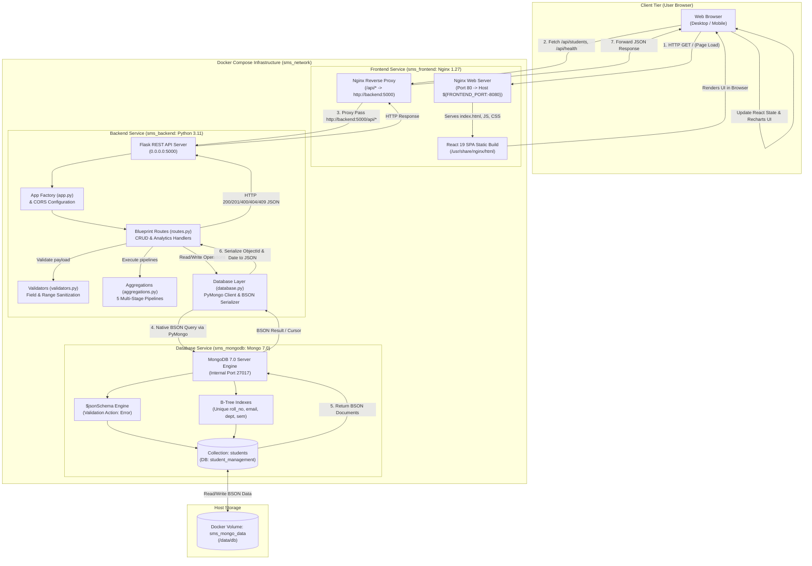
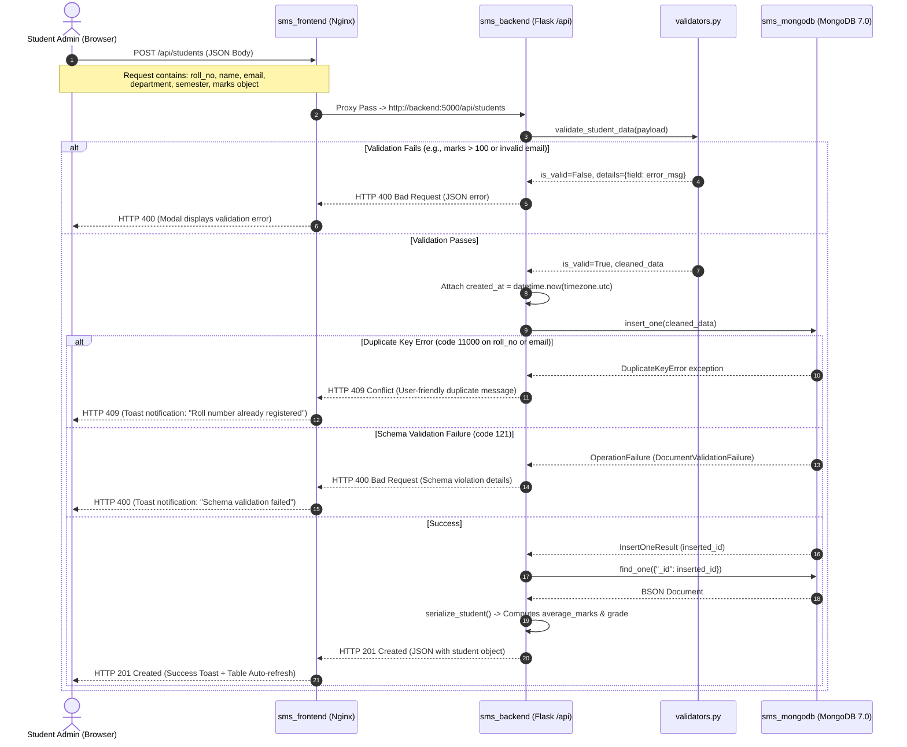

# Comprehensive System Architecture & Technical Reference
## Project: Student Management System (SMS)
### Course: Intelligent NoSQL Databases (CSE494)
**Author**: SHREYA TRIPATHI (Reg No: 12308254, Roll No: 07, Section: K3P23MP)  
**Repository**: [https://github.com/shreya260705/Student-Management-System_NOSQL](https://github.com/shreya260705/Student-Management-System_NOSQL)

---

## 1. Complete System Architecture & Data Flow

The Student Management System is designed as a **decoupled, multi-tier containerized web application**. It consists of three decoupled layers:
1. **Presentation Layer**: A responsive Single Page Application (SPA) built with React 19, Vite, Tailwind CSS, and Recharts, compiled to static assets and served by an Nginx reverse-proxy.
2. **Application & API Layer**: A stateless RESTful microservice built with Python 3.11 and Flask, communicating with MongoDB exclusively via the low-level **PyMongo** driver.
3. **Data Layer**: An official **MongoDB 7.0** document database enforcing collection-level schema validation (`$jsonSchema`) and persistent data storage through a named Docker volume (`sms_mongo_data`).

### High-Level Architecture Diagram



---

### Layer Responsibilities and Technology Justification

| Layer | Component | Core Responsibilities | Technology Justification |
| :--- | :--- | :--- | :--- |
| **Presentation** | React 19 + Vite | State management, dynamic UI rendering, interactive modal workflows, debounced search, client-side sorting/filtering. | **Vite** offers sub-second hot module reloading and small bundle sizes. **React 19** provides functional components and hooks (`useState`, `useEffect`, `useCallback`) for clean state synchronization. |
| **Styling & UI** | Tailwind CSS 3.4 + Lucide | Utility-first CSS classes, responsive grid layout, badge styles, accessibility, and modern iconography. | Eliminates CSS bloat by compiling only the used classes. High maintainability and clean visual hierarchy suitable for academic evaluation. |
| **Visualizations**| Recharts 2.15 | Rendering SVG charts for Department distribution, Grade distribution, Semester trends, and Top performer metrics. | Declarative, React-native chart library that scales responsively without canvas pixelation and provides interactive hover tooltips. |
| **Web Server / Proxy** | Nginx 1.27 Alpine | Serving static frontend build assets, handling Single Page Application URL routing fallback (`try_files`), and reverse-proxying `/api/` traffic to the backend. | Lightweight (under 25MB), fast concurrency handling, isolates backend container from the public network, and avoids CORS issues in production by unifying origin. |
| **Application API** | Flask 3.0 + Flask-CORS | Exposing REST endpoints, parsing query parameters, request validation, BSON serialization, and status code dispatching. | **Flask** is lightweight, explicit, and easy to explain during viva defense. Avoids unnecessary boilerplate while maintaining clear route definitions. |
| **Database Driver**| PyMongo 4.8.0 | Direct TCP connection pooling to MongoDB, BSON document translation, execution of complex aggregation pipelines, index enforcement. | Official MongoDB driver for Python. We deliberately avoided heavy ORMs/ODMs (like MongoEngine or Mongoose) to ensure direct control over native MongoDB pipelines and BSON structures. |
| **Database Engine**| MongoDB 7.0 | Document store, collection-level JSON Schema enforcement, atomic single-document updates, multi-stage aggregation execution. | **MongoDB** stores student profiles and hierarchical subject marks in unified BSON documents, eliminating expensive relational `JOIN` operations. |
| **Infrastructure** | Docker Compose | Multi-container lifecycle orchestration, container healthchecks, internal network DNS resolution, named volume persistence. | Ensures 100% reproducible execution across development, testing, and production environments regardless of the host operating system. |

---

### Request-Response Lifecycle & Error Handling Flow



---

## 2. Complete Project Directory Structure

```
NOSQL_SMS/
├── .env.example                    # Template for Docker environment variables
├── .env                            # Active environment configuration (contains FRONTEND_PORT=8082)
├── .gitignore                      # Git exclusion rules (venv, node_modules, .env, dist)
├── docker-compose.yml              # Multi-tier container orchestration configuration
├── README.md                       # High-level project summary, setup instructions, & API guide
├── PROJECT_ARCHITECTURE.md         # Exhaustive architectural blueprint (this document)
├── PROJECT_REPORT.md               # Formal CSE494 academic report mapped to assignment rubric
├── VIVA_QUESTIONS.md               # 20+ viva defense questions with in-depth technical answers
├── SCREENSHOTS_GUIDE.md            # Step-by-step checklist of 14 screenshots for submission
│
├── backend/                        # Python / Flask Application Service
│   ├── .dockerignore               # Files excluded from backend Docker build context
│   ├── Dockerfile                  # Python 3.11-slim container with non-root user & curl healthcheck
│   ├── requirements.txt            # Python dependencies: Flask, flask-cors, pymongo, python-dotenv, pytest
│   ├── app.py                      # Flask Application Factory, CORS setup, and HTTP error handlers
│   ├── database.py                 # PyMongo client, $jsonSchema validator, B-Tree indexes, & BSON serializer
│   ├── validators.py               # Server-side validation functions (email regex, range limits)
│   ├── aggregations.py             # 5 Mandatory MongoDB Aggregation Pipelines + Dashboard summary executor
│   ├── routes.py                   # REST API routes (Health, CRUD, Analytics, and Dashboard)
│   ├── seed.py                     # Idempotent data seeder (16 realistic students across all grade tiers)
│   └── tests/                      # Automated test suite
│       └── test_api.py             # 14 unit & integration tests running on isolated test database
│
└── frontend/                       # React 19 / Vite Presentation Service
    ├── .dockerignore               # Files excluded from frontend Docker build context
    ├── Dockerfile                  # Multi-stage Dockerfile (Node 22 build -> Nginx 1.27 runtime)
    ├── nginx.conf                  # Nginx configuration (SPA routing fallback and /api reverse proxy)
    ├── package.json                # Frontend dependencies: React 19, Recharts, Lucide-react, Tailwind CSS
    ├── package-lock.json           # Pinned npm dependency lockfile
    ├── vite.config.js              # Vite bundler configuration with local dev proxy (/api -> 5000)
    ├── tailwind.config.js          # Tailwind CSS theme extension and content path configuration
    ├── postcss.config.js           # PostCSS configuration for Tailwind CSS and Autoprefixer
    ├── index.html                  # HTML5 entrypoint with root DOM mount node
    │
    └── src/                        # React Application Source Code
        ├── main.jsx                # Application entrypoint mounting App component into React 19 StrictMode
        ├── App.jsx                 # Master application controller: state, routing tabs, modals, notifications
        ├── index.css               # Tailwind base directives and custom scrollbar styles
        │
        ├── services/
        │   └── api.js              # Centralized API service wrapping window.fetch with error normalization
        │
        ├── components/             # Reusable UI Components
        │   ├── Navbar.jsx          # Top navigation bar with live MongoDB status indicator and refresh button
        │   ├── Sidebar.jsx         # Left navigation drawer with brand icon, menu links, and CSE494 project badge
        │   ├── Toast.jsx           # Auto-dismissing notification banner (Success, Error, Info)
        │   ├── StudentDetailsModal.jsx # Detailed student modal with mark progress bars, average, and grade badge
        │   ├── StudentFormModal.jsx    # Dual-purpose form modal for Adding and Editing students with live validation
        │   └── DeleteConfirmModal.jsx  # Deletion safeguard modal with student verification preview
        │
        └── pages/                  # Main Page Views
            ├── Dashboard.jsx       # 4 KPI cards, Department distribution bar chart, Grade distribution chart, recent list
            ├── Students.jsx        # Searchable, filterable, sortable, and paginated student table directory
            └── Analytics.jsx       # Dedicated analytics dashboard rendering the 5 MongoDB aggregation pipelines
```

---

## 3. MongoDB Database Architecture

### Database Name & Collection
- **Database Name**: `student_management` (Production) / `student_management_test` (Automated Test Suite)
- **Collection Name**: `students`

### Complete Student Document Structure
In MongoDB, student records are stored as flexible, self-contained BSON documents:

```json
{
  "_id": ObjectId("6ad5e0b5657a0ac0b0ffcc4c"),
  "roll_no": "CSE2024001",
  "name": "Aarav Sharma",
  "email": "aarav.sharma@example.com",
  "department": "CSE",
  "semester": 6,
  "marks": {
    "DBMS": 92,
    "DSA": 96,
    "Python": 94
  },
  "created_at": ISODate("2026-10-19T09:04:49.018Z")
}
```

### Detailed Field Specifications

| Field Name | BSON Data Type | Requirement | Constraints & Validations | Real-World Purpose |
| :--- | :--- | :--- | :--- | :--- |
| `_id` | `objectId` | Auto-generated | 12-byte unique BSON identifier | Primary document key in MongoDB |
| `roll_no` | `string` | **Required** | Uppercase, alphanumeric, 3–20 chars. Enforced **Unique Index** (`idx_unique_roll_no`) | Official institutional identification number |
| `name` | `string` | **Required** | Trimmed string, minimum length: 2 chars | Full student legal name |
| `email` | `string` | **Required** | Regex: `^[a-zA-Z0-9._%+-]+@[a-zA-Z0-9.-]+\.[a-zA-Z]{2,}$`. Enforced **Unique Index** (`idx_unique_email`) | Primary institutional contact email |
| `department` | `string` | **Required** | Allowed Enum: `['CSE', 'ECE', 'MECH', 'CIVIL', 'IT', 'AI&DS']`. Indexed (`idx_department`) | Academic discipline/branch |
| `semester` | `int` / `long` | **Required** | Integer between `1` and `8`. Indexed (`idx_semester`) | Current academic standing |
| `marks` | `object` | **Required** | Embedded sub-document with strictly 3 keys: `DBMS`, `DSA`, `Python`. No extra keys allowed (`additionalProperties: false`) | Academic exam scores |
| `marks.DBMS` | `int` / `double` | **Required** | Numeric score between `0` and `100` | Score in Database Management Systems |
| `marks.DSA` | `int` / `double` | **Required** | Numeric score between `0` and `100` | Score in Data Structures & Algorithms |
| `marks.Python`| `int` / `double` | **Required** | Numeric score between `0` and `100` | Score in Python Programming |
| `created_at` | `date` | **Required** | Native BSON Date (UTC timestamp) | Record audit trail and chronological sorting |

---

### Collection-Level `$jsonSchema` Validation

Enforced directly inside the MongoDB database engine in [`backend/database.py`](file:///c:/Users/ramku/Downloads/NOSQL_SMS/backend/database.py#L48-L114):

```python
STUDENT_JSON_SCHEMA = {
    "$jsonSchema": {
        "bsonType": "object",
        "required": ["roll_no", "name", "email", "department", "semester", "marks", "created_at"],
        "properties": {
            "_id": {
                "bsonType": "objectId",
                "description": "MongoDB internal ObjectId"
            },
            "roll_no": {
                "bsonType": "string",
                "description": "Unique student roll number (e.g., CSE2026001)"
            },
            "name": {
                "bsonType": "string",
                "description": "Student full name"
            },
            "email": {
                "bsonType": "string",
                "pattern": "^[a-zA-Z0-9._%+-]+@[a-zA-Z0-9.-]+\\.[a-zA-Z]{2,}$",
                "description": "Valid email address"
            },
            "department": {
                "bsonType": "string",
                "enum": ["CSE", "ECE", "MECH", "CIVIL", "IT", "AI&DS"],
                "description": "Department name from allowed list"
            },
            "semester": {
                "bsonType": ["int", "long", "double"],
                "minimum": 1,
                "maximum": 8,
                "description": "Semester must be an integer between 1 and 8"
            },
            "marks": {
                "bsonType": "object",
                "required": ["DBMS", "DSA", "Python"],
                "properties": {
                    "DBMS":   {"bsonType": ["int", "long", "double"], "minimum": 0, "maximum": 100},
                    "DSA":    {"bsonType": ["int", "long", "double"], "minimum": 0, "maximum": 100},
                    "Python": {"bsonType": ["int", "long", "double"], "minimum": 0, "maximum": 100}
                },
                "additionalProperties": False,
                "description": "Nested document containing subject marks"
            },
            "created_at": {
                "bsonType": "date",
                "description": "Native BSON Date when the student record was created"
            }
        },
        "additionalProperties": False
    }
}
```

#### Why `$jsonSchema` is Superior to Application-Only Validation:
1. **Engine-Level Defense**: Protects against malformed data written by any client, script, or developer accessing the database directly via `mongosh` or MongoDB Compass.
2. **Data Type Guarantee**: Guarantees that numerical aggregations (`$avg`, `$sum`, `$divide`) will never encounter string values in the `marks` fields, which would otherwise abort pipelines.
3. **Graceful Error Code**: If an invalid document is inserted, MongoDB aborts the write with error code `121` (`DocumentValidationFailure`), which `backend/routes.py` catches and translates to HTTP 400.

---

### Indexing Strategy & Performance Impact

MongoDB uses B-Tree indexes to accelerate search operations from $O(N)$ linear scans (`COLLSCAN`) to $O(\log N)$ logarithmic index scans (`IXSCAN`).

| Index Name | Key Fields | Type | Purpose | Query Optimization |
| :--- | :--- | :--- | :--- | :--- |
| `idx_unique_roll_no` | `{"roll_no": 1}` | **Unique** | Enforces institution-wide roll number uniqueness | Fast lookups on search bar & student validation |
| `idx_unique_email` | `{"email": 1}` | **Unique** | Prevents duplicate student registrations | Fast lookup on email verification |
| `idx_department` | `{"department": 1}` | Secondary | Optimizes department filtering & grouping | Accelerates Pipeline 1 and Pipeline 2 |
| `idx_semester` | `{"semester": 1}` | Secondary | Optimizes semester cohort queries | Accelerates Pipeline 5 |
| `idx_name` | `{"name": 1}` | Secondary | Optimizes alphabetical name sorting | Accelerates table sorting by student name |

---

### PyMongo Connection Management & BSON Serialization

1. **Singleton `MongoClient` with Connection Pooling**:
   In [`backend/database.py`](file:///c:/Users/ramku/Downloads/NOSQL_SMS/backend/database.py#L22-L34), `get_client()` maintains a singleton `MongoClient` instance. Creating a new client on every request is an anti-pattern because TCP handshakes and server discovery cause significant latency.
2. **Context-Aware Database Switching**:
   [`backend/routes.py`](file:///c:/Users/ramku/Downloads/NOSQL_SMS/backend/routes.py#L30-L46) defines `get_current_db()`. If Flask is running in testing mode (`app.config['DB_NAME'] = 'student_management_test'`), queries are dynamically redirected to the test database without touching production data.
3. **BSON Serialization Pipeline**:
   Python's native `json` library cannot serialize BSON `ObjectId` or `datetime.datetime` objects. In `database.py`, `serialize_student(doc)` performs the conversion:
   - Converts `doc['_id']` $\to$ `str(doc['_id'])` and maps to `doc['id']`.
   - Converts `doc['created_at']` $\to$ `doc['created_at'].isoformat()`.
   - Calculates derived student-level metrics:
     $$\text{average\_marks} = \text{round}\left(\frac{\text{DBMS} + \text{DSA} + \text{Python}}{3.0}, 2\right)$$
   - Evaluates academic letter grade:
     $$\text{grade} = \begin{cases} \text{A} & \text{if average} \ge 80 \\ \text{B} & \text{if } 70 \le \text{average} < 80 \\ \text{C} & \text{if } 60 \le \text{average} < 70 \\ \text{D} & \text{if } 40 \le \text{average} < 60 \\ \text{F} & \text{if average} < 40 \end{cases}$$

---

## 4. CRUD Operations & API Architecture

### Complete Endpoints Specification Table

| HTTP Method | API Endpoint Path | Purpose | Query Parameters / JSON Request Body | PyMongo Operation Executed | HTTP Status Codes | Source Implementation |
| :--- | :--- | :--- | :--- | :--- | :--- | :--- |
| `GET` | `/` | Root API status & directory | None | None (Static routing) | `200` | [`backend/app.py:L60`](file:///c:/Users/ramku/Downloads/NOSQL_SMS/backend/app.py#L60) |
| `GET` | `/api/health` | System health & Mongo ping | None | `db.command("ping")` & `count_documents({})` | `200` OK, `503` Unavailable | [`backend/routes.py:L52`](file:///c:/Users/ramku/Downloads/NOSQL_SMS/backend/routes.py#L52) |
| `GET` | `/api/dashboard/stats`| Consolidated KPI summary | None | `execute_dashboard_summary(col)` | `200` OK, `500` Error | [`backend/routes.py:L376`](file:///c:/Users/ramku/Downloads/NOSQL_SMS/backend/routes.py#L376) |
| `GET` | `/api/students` | Search, filter, sort, paginate | `page`, `limit`, `search`, `department`, `semester`, `sort_by`, `sort_order` | `col.find(query)` OR `col.aggregate(pipeline)` (when sorting by average marks) | `200` OK, `500` Error | [`backend/routes.py:L89`](file:///c:/Users/ramku/Downloads/NOSQL_SMS/backend/routes.py#L89) |
| `GET` | `/api/students/<id>` | Fetch single student record | Path parameter: `<student_id>` (ObjectId string) | `col.find_one({"_id": ObjectId(student_id)})` | `200` OK, `400` InvalidId, `404` Not Found | [`backend/routes.py:L210`](file:///c:/Users/ramku/Downloads/NOSQL_SMS/backend/routes.py#L210) |
| `POST` | `/api/students` | Enroll new student document | JSON Body: `{roll_no, name, email, department, semester, marks}` | `col.insert_one(validated_data)` | `201` Created, `400` Bad Request, `409` Conflict | [`backend/routes.py:L229`](file:///c:/Users/ramku/Downloads/NOSQL_SMS/backend/routes.py#L229) |
| `PUT` | `/api/students/<id>` | Update student profile/marks | Path parameter: `<id>`, JSON Body: fields to update | `col.update_one({"_id": obj_id}, {"$set": data})` | `200` OK, `400` Validation, `404` Not Found, `409` Duplicate | [`backend/routes.py:L289`](file:///c:/Users/ramku/Downloads/NOSQL_SMS/backend/routes.py#L289) |
| `DELETE`| `/api/students/<id>`| Remove student document | Path parameter: `<student_id>` | `col.delete_one({"_id": obj_id})` | `200` OK, `400` InvalidId, `404` Not Found | [`backend/routes.py:L353`](file:///c:/Users/ramku/Downloads/NOSQL_SMS/backend/routes.py#L353) |
| `GET` | `/api/analytics/department-counts` | Pipeline 1: Dept count | None | `execute_department_counts(col)` | `200` OK, `500` Error | [`backend/routes.py:L390`](file:///c:/Users/ramku/Downloads/NOSQL_SMS/backend/routes.py#L390) |
| `GET` | `/api/analytics/department-averages` | Pipeline 2: Dept avgs | None | `execute_department_averages(col)` | `200` OK, `500` Error | [`backend/routes.py:L404`](file:///c:/Users/ramku/Downloads/NOSQL_SMS/backend/routes.py#L404) |
| `GET` | `/api/analytics/top-students` | Pipeline 3: Top rankers | `limit` (default: 5, max: 20) | `execute_top_students(col, limit)` | `200` OK, `500` Error | [`backend/routes.py:L418`](file:///c:/Users/ramku/Downloads/NOSQL_SMS/backend/routes.py#L418) |
| `GET` | `/api/analytics/grade-distribution` | Pipeline 4: Grades A-F | None | `execute_grade_distribution(col)` | `200` OK, `500` Error | [`backend/routes.py:L433`](file:///c:/Users/ramku/Downloads/NOSQL_SMS/backend/routes.py#L433) |
| `GET` | `/api/analytics/semester-counts` | Pipeline 5: Sem counts | None | `execute_semester_counts(col)` | `200` OK, `500` Error | [`backend/routes.py:L447`](file:///c:/Users/ramku/Downloads/NOSQL_SMS/backend/routes.py#L447) |

---

### Step-by-Step CRUD Operation Walkthrough

#### 1. Create Operation (`POST /api/students`)
1. Client sends JSON payload:
   ```json
   {
     "roll_no": "CSE2024017",
     "name": "Vikram Seth",
     "email": "vikram.seth@example.com",
     "department": "CSE",
     "semester": 4,
     "marks": { "DBMS": 88, "DSA": 92, "Python": 90 }
   }
   ```
2. `validators.validate_student_data` sanitizes input, validates string lengths, regex patterns, and checks that marks are between 0 and 100.
3. Attaches server timestamp: `created_at = datetime.now(timezone.utc)`.
4. Executes `collection.insert_one(validated_data)`.
5. If MongoDB raises `DuplicateKeyError` (code 11000): returns HTTP 409 Conflict with field-specific guidance (`roll_no` or `email`).
6. If successful: returns HTTP 201 Created with the serialized student record.

#### 2. Read Operation (`GET /api/students`)
1. Parses query parameters: `search`, `department`, `semester`, `sort_by`, `sort_order`, `page`, `limit`.
2. Assembles `$or` regex filter across `name`, `roll_no`, and `email` for flexible searching.
3. If sorting by `average_marks` (computed field): passes query through an aggregation pipeline with `$project` calculating average marks, followed by `$facet` to compute total count and paginated items in a single database roundtrip.
4. Returns HTTP 200 with students list and pagination metadata (`total`, `page`, `total_pages`, `has_next`, `has_prev`).

#### 3. Update Operation (`PUT /api/students/<student_id>`)
1. Validates `ObjectId.is_valid(student_id)`. Returns 400 if malformed.
2. Checks document existence via `collection.find_one({"_id": obj_id})`. Returns 404 if missing.
3. Validates update payload via `validate_student_data(data, is_update=True)`.
4. Executes atomic document update: `collection.update_one({"_id": obj_id}, {"$set": validated_data})`.
5. Returns HTTP 200 with the freshly re-fetched and serialized student record.

#### 4. Delete Operation (`DELETE /api/students/<student_id>`)
1. Validates `ObjectId.is_valid(student_id)`.
2. Executes `collection.delete_one({"_id": obj_id})`.
3. If `deleted_count == 0`: returns HTTP 404 Not Found.
4. If successful: returns HTTP 200 with `{"message": "Student record deleted successfully"}`.

---

## 5. Aggregation Pipeline Architecture

All aggregation pipelines are encapsulated in [`backend/aggregations.py`](file:///c:/Users/ramku/Downloads/NOSQL_SMS/backend/aggregations.py).

### Pipeline 1: Department-wise Student Count
- **Real-World Question**: *How many students are enrolled in each academic department across the university?*
- **Python Function**: `get_department_counts_pipeline()`
- **Pipeline Stages**:
  ```python
  [
      # Stage 1: Group documents by department field and increment counter
      {"$group": {"_id": "$department", "count": {"$sum": 1}}},
      # Stage 2: Sort descending by student count
      {"$sort": {"count": -1, "_id": 1}},
      # Stage 3: Reshape output fields to {department, count}
      {"$project": {"_id": 0, "department": "$_id", "count": 1}}
  ]
  ```
- **Output Structure**: `[{"department": "CSE", "count": 4}, {"department": "ECE", "count": 3}, ...]`
- **Frontend Usage**: Displayed on **Dashboard** (Bar chart) and **Analytics Page** (Chart 1).

---

### Pipeline 2: Average Marks by Department
- **Real-World Question**: *Which academic departments are performing best overall, and what is the mean score per department?*
- **Python Function**: `get_department_averages_pipeline()`
- **Pipeline Stages**:
  ```python
  [
      # Stage 1: Compute individual student average mark across the 3 subjects
      {
          "$project": {
              "department": 1,
              "student_avg": {
                  "$divide": [
                      {
                          "$add": [
                              {"$ifNull": ["$marks.DBMS", 0]},
                              {"$ifNull": ["$marks.DSA", 0]},
                              {"$ifNull": ["$marks.Python", 0]}
                          ]
                      },
                      3.0
                  ]
              }
          }
      },
      # Stage 2: Group by department and compute average of student averages
      {
          "$group": {
              "_id": "$department",
              "average_marks": {"$avg": "$student_avg"},
              "student_count": {"$sum": 1}
          }
      },
      # Stage 3: Round average marks to 2 decimal places and format fields
      {
          "$project": {
              "_id": 0,
              "department": "$_id",
              "average_marks": {"$round": ["$average_marks", 2]},
              "student_count": 1
          }
      },
      # Stage 4: Order descending by average marks
      {"$sort": {"average_marks": -1}}
  ]
  ```
- **Output Structure**: `[{"department": "CSE", "average_marks": 79.42, "student_count": 4}, ...]`
- **Frontend Usage**: Displayed on **Analytics Page** (Chart 2: Department Academic Comparison).

---

### Pipeline 3: Top 5 Students Ranked by Average Marks
- **Real-World Question**: *Who are the top 5 highest-achieving students in the institution, and what letter grades did they earn?*
- **Python Function**: `get_top_students_pipeline(limit=5)`
- **Pipeline Stages**:
  ```python
  [
      # Stage 1: Compute average score for each student
      {
          "$project": {
              "roll_no": 1, "name": 1, "email": 1, "department": 1, "semester": 1, "marks": 1,
              "average_marks": {
                  "$round": [
                      {"$divide": [{"$add": [{"$ifNull": ["$marks.DBMS", 0]}, {"$ifNull": ["$marks.DSA", 0]}, {"$ifNull": ["$marks.Python", 0]}]}, 3.0]},
                      2
                  ]
              }
          }
      },
      # Stage 2: Categorize letter grade using conditional $switch expression
      {
          "$addFields": {
              "grade": {
                  "$switch": {
                      "branches": [
                          {"case": {"$gte": ["$average_marks", 80]}, "then": "A"},
                          {"case": {"$gte": ["$average_marks", 70]}, "then": "B"},
                          {"case": {"$gte": ["$average_marks", 60]}, "then": "C"},
                          {"case": {"$gte": ["$average_marks", 40]}, "then": "D"}
                      ],
                      "default": "F"
                  }
              }
          }
      },
      # Stage 3: Sort descending by average marks
      {"$sort": {"average_marks": -1, "name": 1}},
      # Stage 4: Restrict to top N students
      {"$limit": limit},
      # Stage 5: Clean output fields and serialize ObjectId
      {
          "$project": {
              "_id": {"$toString": "$_id"},
              "id": {"$toString": "$_id"},
              "roll_no": 1, "name": 1, "email": 1, "department": 1, "semester": 1, "marks": 1,
              "average_marks": 1, "grade": 1
          }
      }
  ]
  ```
- **Output Structure**: `[{"roll_no": "CSE2024001", "name": "Aarav Sharma", "average_marks": 94.0, "grade": "A", ...}]`
- **Frontend Usage**: Feeds the **Top Performer KPI card** on Dashboard and the **Top 5 Leaderboard Table** on Analytics.

---

### Pipeline 4: Academic Grade Distribution
- **Real-World Question**: *How are students distributed across academic grade tiers (A, B, C, D, F)?*
- **Python Function**: `get_grade_distribution_pipeline()` & `execute_grade_distribution()`
- **Pipeline Stages**:
  ```python
  [
      # Stage 1: Project student average marks
      {
          "$project": {
              "average_marks": {
                  "$divide": [{"$add": [{"$ifNull": ["$marks.DBMS", 0]}, {"$ifNull": ["$marks.DSA", 0]}, {"$ifNull": ["$marks.Python", 0]}]}, 3.0]
              }
          }
      },
      # Stage 2: Evaluate letter grade via $switch
      {
          "$project": {
              "grade": {
                  "$switch": {
                      "branches": [
                          {"case": {"$gte": ["$average_marks", 80]}, "then": "A"},
                          {"case": {"$gte": ["$average_marks", 70]}, "then": "B"},
                          {"case": {"$gte": ["$average_marks", 60]}, "then": "C"},
                          {"case": {"$gte": ["$average_marks", 40]}, "then": "D"}
                      ],
                      "default": "F"
                  }
              }
          }
      },
      # Stage 3: Group by assigned grade letter and sum frequency
      {"$group": {"_id": "$grade", "count": {"$sum": 1}}},
      # Stage 4: Reshape output to {grade, count}
      {"$project": {"_id": 0, "grade": "$_id", "count": 1}}
  ]
  ```
- **Zero-Fill Guarantee**: `execute_grade_distribution()` guarantees that all canonical grades `['A', 'B', 'C', 'D', 'F']` exist in the returned list, even if a tier currently has zero students.
- **Frontend Usage**: Displayed on **Dashboard** (Bar chart) and **Analytics Page** (Chart 3).

---

### Pipeline 5: Semester-wise Student Count
- **Real-World Question**: *What is the student enrollment distribution across semesters 1 through 8?*
- **Python Function**: `get_semester_counts_pipeline()`
- **Pipeline Stages**:
  ```python
  [
      # Stage 1: Group by semester integer
      {"$group": {"_id": "$semester", "count": {"$sum": 1}}},
      # Stage 2: Sort chronologically from Semester 1 to 8
      {"$sort": {"_id": 1}},
      # Stage 3: Clean field names to {semester, count}
      {"$project": {"_id": 0, "semester": "$_id", "count": 1}}
  ]
  ```
- **Output Structure**: `[{"semester": 1, "count": 2}, {"semester": 2, "count": 2}, ...]`
- **Frontend Usage**: Displayed on **Analytics Page** (Chart 4: Semester Progression).

---

## 6. Docker & Container Deployment Architecture

### Compose Services Specification

| Service Name | Container Name | Base Image | Build Strategy | Host Ports | Internal Ports | Volumes & Mounts | Healthcheck Command | Dependencies |
| :--- | :--- | :--- | :--- | :--- | :--- | :--- | :--- | :--- |
| `mongodb` | `sms_mongodb` | `mongo:7.0` | Official Image | None (Isolated) | `27017` | `sms_mongo_data:/data/db` | `mongosh --eval 'db.adminCommand("ping")'` | None |
| `backend` | `sms_backend` | `python:3.11-slim` | Single-stage Dockerfile | `5000:5000` | `5000` | Code copied into image | `curl -f http://localhost:5000/api/health` | `mongodb: service_healthy` |
| `frontend` | `sms_frontend` | `nginx:1.27-alpine` | Multi-stage (Node 22 $\to$ Nginx) | `${FRONTEND_PORT:-8080}:80` | `80` | Built assets copied to Nginx html | `wget -qO- http://127.0.0.1/` | `backend: service_healthy` |

---

### Key DevOps Implementation Details

1. **Why `mongodb` Hostname Instead of `localhost`?**:
   Inside Docker, each container has its own network namespace and loopback interface (`127.0.0.1`). Connecting to `localhost:27017` inside `sms_backend` would attempt to connect to port 27017 inside the backend container itself, causing `Connection refused`. Docker provides an **embedded DNS server** that resolves container and service names defined in `docker-compose.yml`. Hence, the backend connects to `mongodb://mongodb:27017/`.
2. **Reverse Proxy & Single Origin**:
   The browser connects to `http://localhost:8082`. When the browser makes a request to `/api/students`:
   - Nginx receives the request on port 80.
   - Nginx matches `location /api` and forwards the request over the internal network to `http://backend:5000/api/students`.
   - The browser never communicates directly with `backend:5000`, eliminating cross-origin resource sharing (CORS) complexities in production.
3. **Port Conflict Resolution (`FRONTEND_PORT=8082`)**:
   During live testing, Windows service `Jenkins` was running on host port `8080`. Hardcoding `8080:80` caused `bind: address already in use`. The Compose file was updated to:
   ```yaml
   ports:
     - "${FRONTEND_PORT:-8080}:80"
   ```
   Setting `FRONTEND_PORT=8082` in root `.env` allows the application to start cleanly alongside host services.
4. **Data Persistence Semantics**:
   - `docker compose down`: Removes containers and network, but **preserves** the named volume `sms_mongo_data`. When restarting with `docker compose up -d`, all student records remain intact.
   - `docker compose down -v`: Destructive command that deletes the named volume and erases all MongoDB data.

---

## 7. Frontend Architecture

### Component Hierarchy

```
App.jsx (Root Controller: State, Health, Modals, Toasts)
├── Sidebar.jsx (Navigation Tabs, Brand, Project Info)
├── Navbar.jsx (Header Title, Live DB Status Badge, Refresh Button, Add Student CTA)
├── Main Content Views (Conditional Rendering by activeTab)
│   ├── Dashboard.jsx
│   │   ├── 4 KPI Cards (Total Students, Depts, Mean Score, Top Performer)
│   │   ├── Recharts Bar Chart (Department-wise Distribution)
│   │   ├── Recharts Bar Chart (Academic Grade Distribution)
│   │   └── Recent Students Table (Chronological BSON Date view)
│   ├── Students.jsx
│   │   ├── Search Input (Name, Roll No, Email)
│   │   ├── Dropdown Filters (Department, Semester)
│   │   ├── Sort Controls (Created Date, Name, Roll No, Average Marks)
│   │   ├── Responsive Students Table (Roll, Name, Dept, Sem, Marks, Grade Badge, Actions)
│   │   └── Pagination Controls (Prev, Next, Page X of Y, Count)
│   └── Analytics.jsx
│       ├── Pipeline 1 Chart: Department-wise Student Count + Stage Explanations
│       ├── Pipeline 2 Chart: Average Marks by Department + Stage Explanations
│       ├── Pipeline 3 Leaderboard: Top 5 Students Table with Medals + Stage Explanations
│       ├── Pipeline 4 Chart: Grade Distribution + Stage Explanations
│       └── Pipeline 5 Chart: Semester-wise Student Count + Stage Explanations
├── Modals & Overlays
│   ├── StudentFormModal.jsx (Dual-mode Create / Edit form with live validation)
│   ├── StudentDetailsModal.jsx (Full Profile, marks progress bars, grade badge)
│   └── DeleteConfirmModal.jsx (Safe deletion dialog with student summary)
└── Toast.jsx (Auto-dismissing alert notifications)
```

### UI Features & State Management
- **Live Health Status**: `Navbar.jsx` polls `/api/health` and displays a pulsating green badge when MongoDB is connected, or a red alert badge if disconnected.
- **Client & Server Validation**: `StudentFormModal.jsx` validates inputs client-side, while also parsing and displaying backend validation errors if returned by Flask.
- **Graceful Empty & Loading States**: Every table and chart displays animated skeleton loaders during fetches and informative empty messages when no data matches active filters.

---

## 8. Testing & Verification Architecture

### Automated Test Suite ([`backend/tests/test_api.py`](file:///c:/Users/ramku/Downloads/NOSQL_SMS/backend/tests/test_api.py))

The test suite runs 14 automated tests using Python's `unittest` framework:

```
Ran 14 tests in 0.353s
OK
```

#### Test Data Isolation Architecture:
1. `setUpClass` overrides Flask application settings:
   `app.config['DB_NAME'] = 'student_management_test'`
2. All database mutations (create, update, delete) occur exclusively within `student_management_test`.
3. `tearDownClass` issues `client.drop_database('student_management_test')`.
4. **Result**: The user's primary academic database (`student_management`) containing the 16 seeded records is never cleared or corrupted during test execution.

#### Automated Test Matrix:

| Test Case Name | Component Tested | Assertions Verified |
| :--- | :--- | :--- |
| `test_health_check` | Health Endpoint | HTTP 200, `status == 'healthy'`, `mongodb == 'connected'` |
| `test_create_student_success` | Create Student | HTTP 201, BSON date generated, average = 85.0, grade = 'A' |
| `test_duplicate_roll_number` | Unique Index | HTTP 409 Conflict returned when duplicate `roll_no` inserted |
| `test_duplicate_email` | Unique Index | HTTP 409 Conflict returned when duplicate `email` inserted |
| `test_invalid_marks_out_of_bounds` | Data Validation | HTTP 400 returned for marks $> 100$ or $< 0$ |
| `test_invalid_semester` | Range Validation | HTTP 400 returned for semester $> 8$ or $< 1$ |
| `test_invalid_email_format` | Regex Validation | HTTP 400 returned for malformed email string |
| `test_get_student_by_id` | Read Single Record | HTTP 200, retrieves record matching ObjectId |
| `test_get_nonexistent_student` | Error Handling | HTTP 404 returned for nonexistent ObjectId |
| `test_search_and_filter_students` | Query Engine | Search query matches student name; dept filter isolates department |
| `test_update_student` | Update Record | HTTP 200, updates marks, recalculates average to 90.0 and grade to 'A' |
| `test_delete_student` | Delete Record | HTTP 200, subsequent GET returns HTTP 404 |
| `test_aggregation_pipelines` | All 5 Pipelines | Validates output counts and math across all 5 pipelines |
| `test_dashboard_stats` | Dashboard Summary | Verifies KPI counts and highest scoring student identification |

---

## 9. CSE494 Assignment Compliance Matrix

This matrix maps every evaluation criteria from the **CSE494 Intelligent NoSQL Databases** assignment to our exact implementation.

| Rubric Category | Assignment Requirement | Corresponding Project Implementation | Source File & Function | Demonstration & Evidence |
| :--- | :--- | :--- | :--- | :--- |
| **Problem Statement (15 Marks)** | Real-world scenario justification for NoSQL | Student record management with embedded marks and fast academic aggregations | [`PROJECT_REPORT.md:§2`](file:///c:/Users/ramku/Downloads/NOSQL_SMS/PROJECT_REPORT.md) | Demonstrate high read throughput without multi-table SQL `JOIN`s |
| **Document Design (15 Marks)** | Appropriate schema with nested documents & BSON types | `students` collection with embedded `marks` sub-document, BSON Date, and ObjectId | [`backend/database.py:L48`](file:///c:/Users/ramku/Downloads/NOSQL_SMS/backend/database.py#L48) | Screenshot 12: Inspect documents in MongoDB Compass |
| **Schema Validation (15 Marks)**| Collection-level `$jsonSchema` validation | MongoDB `$jsonSchema` validator enforcing required fields, semester $1-8$, marks $0-100$ | [`backend/database.py:L48-114`](file:///c:/Users/ramku/Downloads/NOSQL_SMS/backend/database.py#L48-L114) | Screenshot 05: Submit marks = 120 and show HTTP 400 rejection |
| **Indexing (15 Marks)** | Meaningful B-Tree indexes | Unique indexes on `roll_no` and `email`; secondary indexes on `department`, `semester`, `name` | [`backend/database.py:L150-165`](file:///c:/Users/ramku/Downloads/NOSQL_SMS/backend/database.py#L150-L165) | Screenshot 13: View Indexes tab in MongoDB Compass |
| **CRUD Operations (15 Marks)** | Complete Create, Read, Update, Delete APIs | Full REST API endpoints with pagination, search regex, filter, and error status codes | [`backend/routes.py:L88-370`](file:///c:/Users/ramku/Downloads/NOSQL_SMS/backend/routes.py#L88-L370) | Screenshots 02, 04, 07, 08, 09: CRUD in React UI |
| **Aggregation Pipelines (15 Marks)**| Multi-stage data processing pipelines | 5 dedicated aggregation pipelines utilizing `$group`, `$project`, `$sort`, `$limit`, `$switch` | [`backend/aggregations.py`](file:///c:/Users/ramku/Downloads/NOSQL_SMS/backend/aggregations.py) | Screenshots 10 & 11: Real-time charts on Analytics page |
| **PyMongo Integration (15 Marks)**| Low-level Python driver implementation | Direct PyMongo queries, connection pooling, and BSON serialization | [`backend/database.py`](file:///c:/Users/ramku/Downloads/NOSQL_SMS/backend/database.py) & [`routes.py`](file:///c:/Users/ramku/Downloads/NOSQL_SMS/backend/routes.py) | Live code demonstration showing PyMongo syntax |
| **Sample Seeding (15 Marks)**| Realistic seed data covering all scenarios | Idempotent `seed.py` inserting 16 students across 6 departments and all grade tiers (A-F) | [`backend/seed.py`](file:///c:/Users/ramku/Downloads/NOSQL_SMS/backend/seed.py) | Execute `docker compose exec backend python seed.py` |
| **Report (5 Marks)** | Formal academic project documentation | Detailed academic project report explaining design, schema, and queries | [`PROJECT_REPORT.md`](file:///c:/Users/ramku/Downloads/NOSQL_SMS/PROJECT_REPORT.md) | Submit PDF/Markdown report with diagrams |
| **Presentation & Viva (10 Marks)**| Viva defense readiness | 20+ comprehensive viva questions and technical answers covering NoSQL & architecture | [`VIVA_QUESTIONS.md`](file:///c:/Users/ramku/Downloads/NOSQL_SMS/VIVA_QUESTIONS.md) | Oral defense of BSON, schema design, and aggregation stages |

---

## 10. Design Decisions, Security Controls, and Limitations

### Key Design Decisions

1. **Why Embedded Document for Subject Marks?**:
   - In student administration, a student's marks are strictly accessed together with the student profile.
   - Embedding marks inside the student document achieves **data locality**. When querying a student record, the marks are retrieved in the exact same disk seek.
   - Eliminates the need for relational foreign keys, junction tables, or expensive `$lookup` pipeline stages.
2. **Why PyMongo Over an ODM (like MongoEngine or Mongoose)?**:
   - Direct exposure to MongoDB's native BSON types and aggregation syntax.
   - Avoids hidden query overhead and abstraction layers.
   - Enables clear academic explanation of MongoDB query operators (`$divide`, `$switch`, `$addFields`, `$facet`).
3. **Decoupled Frontend and Backend**:
   - The React frontend communicates strictly via HTTP REST endpoints.
   - Allows independent development, testing, and deployment.
   - Backend can serve multiple clients (web, mobile app, CLI) without modifications.

### Security Controls Implemented

- **Non-Root Container Execution**: The backend container creates and runs as `appuser:appuser` (UID 1000) rather than `root`.
- **Network Isolation**: The MongoDB container does not publish port 27017 to the host network. It is reachable only by services connected to the internal bridge network `sms_network`.
- **Database Schema Validation**: Collection-level `$jsonSchema` prevents arbitrary or malformed data injection.
- **Environment Isolation**: No credentials or secrets are committed to version control. Configuration is loaded via `.env` files.
- **Client & Server Input Sanitization**: Strings are trimmed, emails are validated against regex, and numbers are validated before database writes.

### Current Limitations & Future Roadmap

| Area | Current Implementation | Future Enhancement Roadmap |
| :--- | :--- | :--- |
| **Authentication** | Open administrative access (single role) | Add JWT authentication and Role-Based Access Control (RBAC: Admin, Faculty, Student) |
| **Elective Subjects**| Fixed 3 core subjects (DBMS, DSA, Python) | Support dynamic elective subject arrays with variable credit weights |
| **High Availability** | Standalone MongoDB container with named volume | Configure a 3-node MongoDB Replica Set with automatic failover |
| **Horizontal Scaling**| Single database instance | Implement horizontal sharding across department keys for campus-scale deployment |
